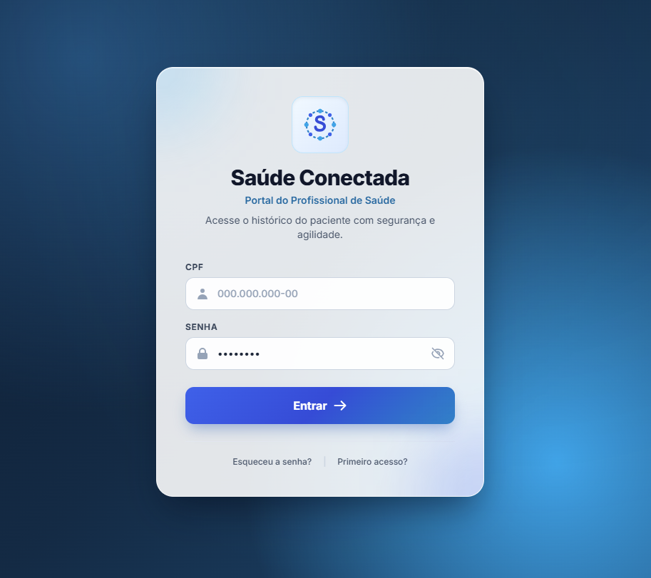
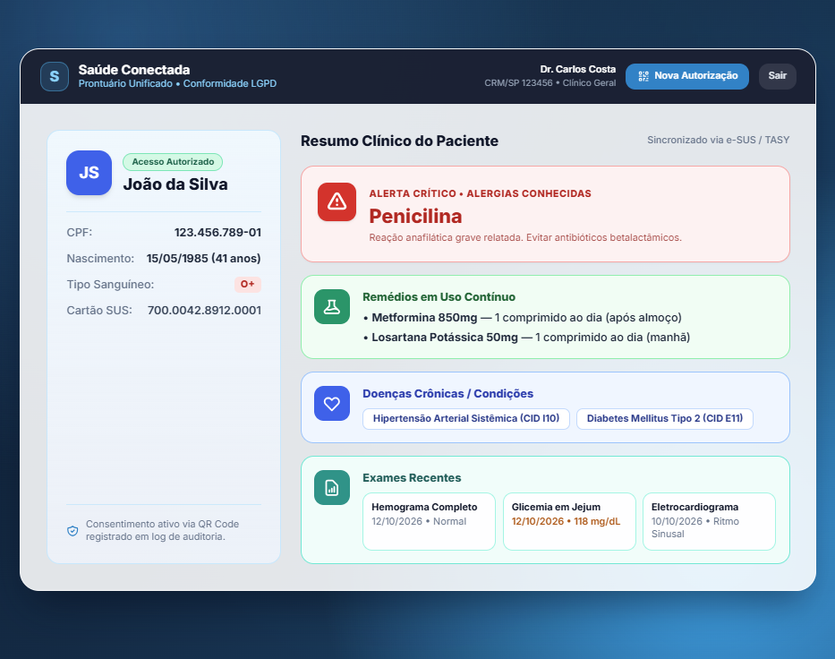
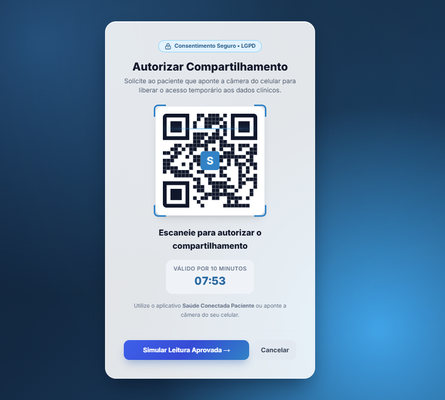

# Relatório Final - Saúde Conectada

## 1. INTRODUÇÃO
### 1.1 Contextualização do problema
Os dados de saúde da população brasileira estão fragmentados em diferentes plataformas que não se comunicam. Um paciente atendido em outra cidade não tem seu histórico acessível, comprometendo a segurança clínica.

### 1.2 Objetivos
Desenvolver e simular uma solução de compartilhamento de dados de saúde que permita a integração de informações essenciais do paciente entre diferentes instituições.

### 1.3 Justificativa
A fragmentação gera retrabalho e riscos de erros médicos. O projeto propõe a unificação segura, em conformidade com a LGPD.

## 2. REFERENCIAL TEÓRICO
### 2.1 Sistemas de informação em saúde no Brasil
e-SUS, PEC e-SUS, TASY, TOTVS.

### 2.2 LGPD e LGPD na Saúde
Respeito à privacidade e ao consentimento do paciente.

## 3. METODOLOGIA
Pesquisa dos sistemas, mapeamento de fluxo, coleta de dados fictícios e criação de protótipo.

## 4. DIAGNÓSTICO
### 4.1 Estrutura física (simulada)
Ambiente acadêmico com laboratórios de informática.

### 4.2 Estrutura administrativa (simulada)
Fluxo típico de clínicas de pequeno porte.

### 4.3 Pontos positivos, negativos e fragilidades
**Positivos:** Possibilidade de simular sem expor dados reais.
**Negativos:** Ausência de parceiro real nesta fase.
**Fragilidades:** Sistemas que não conversam e falta de padronização.

## 5. PROPOSTA DE MELHORIAS
### 5.1 Dados essenciais
Alergias, doenças crônicas, medicamentos em uso e exames recentes.

### 5.2 Ferramentas de otimização
Portal simulado com autorização via QR Code.

## 6. SIMULAÇÃO E AVALIAÇÃO
### 6.1 Protótipo (telas)
Tela de login, resumo do paciente e QR Code de autorização.

Abaixo estão as telas do sistema simulado, demonstrando o fluxo de compartilhamento seguro de dados:

**Tela 1 – Login do Profissional:**

**Tela 2 – Resumo Clínico do Paciente:**

**Tela 3 – Autorização via QR Code (LGPD):**

### 6.2 Métricas de sucesso
Redução do tempo de acesso e diminuição de erros clínicos.

## 7. CONCLUSÃO
A simulação demonstra que a unificação de dados essenciais é viável e melhora a segurança do paciente.

## 8. REFERÊNCIAS
BRASIL. Lei Geral de Proteção de Dados (LGPD).
